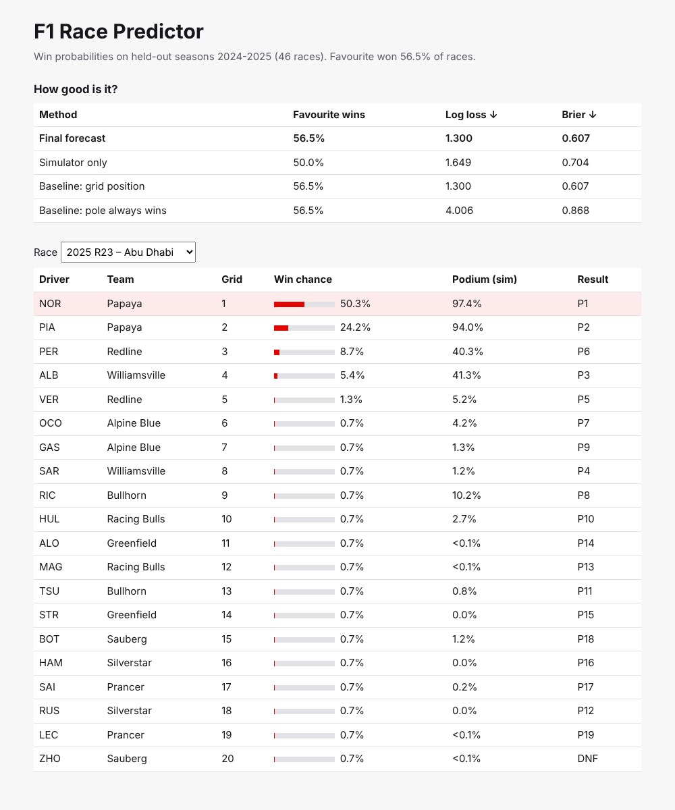

# F1 Race Predictor

Who will win the next Grand Prix? A machine-learning **pace model** (TensorFlow/Keras) predicts each driver's speed, retirement risk and tyre wear before the race. A **multithreaded C++ Monte Carlo simulator** then races the field lap by lap 100,000 times. The share of simulated races each driver wins is their win probability. A **FastAPI + React/TypeScript dashboard** shows the result.

The project is built to be judged honestly: train/test split by season, two baselines, proper probability metrics, and a "What broke and why" section.



## Architecture

```
Jolpica API (real, free) / FastF1 (real, needs F1TV) / sample generator
        │  validate every row (Pydantic), reject + log bad rows
        ▼
SQLite: races, results ──► features (past races only) ──► Keras pace model
                                                              │ pace, DNF risk, tyre wear
                                                              ▼
                                         C++ simulator (std::thread, pybind11)
                                                              │ win / podium probabilities
                                                              ▼
                                   evaluation vs baselines ──► predictions.json
                                                              ▼
                                         FastAPI ──► React + TypeScript dashboard
```

## Quick start (sample data, no internet needed)

```bash
pip install -r requirements.txt
cmake -S cpp -B cpp/build && cmake --build cpp/build -j    # builds f1sim/_racesim (C++)
python -m f1sim.data.make_sample_db f1_sample.sqlite
python -m f1sim.pipeline --db f1_sample.sqlite --sims 20000
python benchmark.py                                         # C++ vs Python speed
python quantize.py                                          # int8 TensorFlow Lite experiment

uvicorn api.main:app --port 8000          # backend
cd web && npm install && npm run dev      # dashboard on http://localhost:5173
# or everything at once:  docker compose up --build   ->  http://localhost:8080
```

## Real data

### Option 1: Jolpica (free, no account), recommended

```bash
python -m f1sim.data.jolpica_loader --from 2018 --to 2025 --db f1.sqlite
python -m f1sim.pipeline --db f1.sqlite --sims 100000
```

[Jolpica](https://github.com/jolpica/jolpica-f1) is the community replacement for the old Ergast API. The loader uses only the Python standard library.

* **Rate limits:** the API allows short bursts but only a few hundred requests per hour. The loader waits 8 seconds between requests (`--delay`) and backs off when it gets HTTP 429.
* **Runtime:** one race takes about 15 requests, because lap times come 100 per page. The first full run takes several hours, so leave it running overnight or start with `--from 2023 --to 2025`.
* **Restarts:** every response is cached in `jolpica_cache/`. If the run stops, restart it and it skips what it already has.

Per driver and race it computes:
* gap to pole (best of Q1–Q3);
* median clean-lap pace vs. the field;
* pit stops;
* retirements.

Jolpica has no track-status flags, so "clean" laps are approximated:
* lap 1 and pit in/out laps are dropped;
* laps where the whole field is >10% slow (safety car) are dropped;
* each driver's laps >7% slower than their own median are dropped.

**What it can't provide:**
* **Tyre wear:** the column stays empty, the model's tyre head gets zero weight, and the simulator uses the team average (a 0.08 s/lap default).
* **Weather:** rain = False, 25 °C.

Races shorter than 20 laps (e.g. Spa 2021) fail validation and are logged to `rejected_rows.jsonl`. That is intended.

### Option 2: FastF1 (adds tyre wear and weather, needs a paid F1TV account)

Since late 2026, FastF1 needs an F1TV Access/Pro/Premium login. Set the credentials as environment variables (`F1_USERNAME`, `F1_PASSWORD`) and never commit them.

```bash
pip install fastf1
python -m f1sim.data.fastf1_loader --from 2018 --to 2025 --db f1.sqlite
```

Circuit type, overtaking difficulty and pit-lane loss come from small hand-made tables in both loaders. Those are the first things to improve.

## Evaluation design

* **Split by time.** Fit on 2018–2022, tune on 2023, test on 2024–2025. Test seasons are touched once, at the end. No random shuffling: that would leak future information into training.
* **Features use only the past.** A feature for race N uses races 1..N-1 plus qualifying for race N. A test (`test_features_do_not_use_the_current_race`) changes one race's result and checks that race's features do not move.
* **Two baselines:** "pole always wins", and "win chance by grid slot" learned from the training seasons.
* **Metrics:** top-1 accuracy, log loss, Brier score, and calibration (does "30%" happen 30% of the time?).

## Results on real F1 data (Jolpica, 2018–2026)

Two experiments, each fully separated in time: fit the model on older seasons, choose settings on one validation season, and test once on seasons it has never seen. 20,000 simulated races per Grand Prix.

**A. Old rules:** fit 2018–2022, validate 2023, test 2024–2025 (48 races)

| Method | Favourite wins | Log loss ↓ | Brier ↓ |
|---|---|---|---|
| Final forecast (validation chose 100% simulator) | 52.1% | 1.457 | 0.680 |
| Baseline: win chance by grid slot | **56.3%** | **1.455** | **0.637** |
| Baseline: pole always wins | **56.3%** | 4.031 | 0.873 |

**B. New 2026 rules:** fit 2018–2024, validate 2025, test 2026 (21 races)

| Method | Favourite wins | Log loss ↓ | Brier ↓ |
|---|---|---|---|
| Simulator only | 61.9% | 1.212 | 0.514 |
| **Final forecast** (validation chose 75% simulator + 25% grid) | 66.7% | **1.163** | **0.490** |
| Baseline: win chance by grid slot | **71.4%** | 1.294 | 0.531 |
| Baseline: pole always wins | **71.4%** | 2.634 | 0.570 |

Calibration error of the final forecast: 0.013 (A) and 0.009 (B).

**What this says**
* **On 2024–2025 the simulator only ties the grid baseline.** Log loss is level (1.457 vs 1.455) and Brier is worse. Validation on 2023 trusted the simulator fully, but 2023 was a season one car dominated, where "fastest car wins" works very well. 2024–2025 were much closer, and grid position carried more information. The validation season wasn't representative of the test seasons, so the setting it chose didn't transfer.
* **On 2026 the blended forecast beats the grid baseline on both probability scores** (log loss 1.163 vs 1.294, Brier 0.490 vs 0.531). It still names the winner slightly less often (14 vs 15 of 21). So its probabilities are better spread, but its top pick isn't.
* **The tuned settings jump between the edges of their ranges.** With 2023 as validation, the smallest start gap and overtaking factor won. With 2025 as validation, the largest won. The best way to simulate a race clearly changes from season to season, and one global setting is too blunt.
* **Small samples.** 21 races is few: one race moves "favourite wins" by about 5 points. Treat the 2026 gain as encouraging, not proven. A bootstrap confidence interval over races is the next step before claiming it.
* **Missing inputs.** Jolpica has no tyre or weather data, so tyre wear uses a constant and rain is always "no". FastF1 data would add both.

## Results on the sample data

These numbers come from the **synthetic** data in `f1sim/data/sample.py`, used to build and debug the system before real data was available.

| Method (46 test races, 2024–2025) | Favourite wins | Log loss ↓ | Brier ↓ |
|---|---|---|---|
| Simulator only (pace model + C++ simulator) | 50.0% | 1.649 | 0.704 |
| Baseline: win chance by grid slot | 56.5% | **1.300** | **0.607** |
| Baseline: pole always wins | 56.5% | 4.006 | 0.868 |
| **Final forecast** (blend chosen on validation) | 56.5% | **1.300** | **0.607** |

* Pace model: mean absolute error **0.144 s/lap** on test vs. 0.190 for "same as the driver's recent form".
* Calibration error of the final forecast: **0.008** (see `results/calibration.png`).
* C++ vs Python (100,000 races, 20 drivers, 57 laps): Python ≈ 89 s (estimated from 2,000 races), C++ 5.4 s on 1 thread (**16×**), 3.1 s on 2 threads (**28×**).

## What broke and why

1. **The simulator lost to "win chance by grid slot".** The first version gave pole sitters a 39% win chance; in the data they won 57%. The simulator underrated track position. Tuning its starting-gap and overtaking settings on the validation season helped (log loss 1.91 → 1.65), but the tuner kept choosing the largest starting gap offered. That's a sign the simulator's model of racing is missing something, not a sign to keep widening the search.
2. **So I let validation decide.** The final forecast blends simulator and grid baseline with a weight chosen on 2023. Validation chose **0% simulator**: every step towards the simulator made validation log loss worse (1.48 → 2.43). On this data, qualifying already reveals almost all of each car's speed, so the pace model adds noise rather than information. Whether that holds for real F1, where race pace, tyre management and strategy differ from qualifying, is exactly what the real-data run tests.
3. **Retirements are not predictable from these features.** The DNF output has AUC ≈ 0.5 and predicted far too few retirements (2.7% vs 8.5%). I calibrated it on validation, so the simulator at least uses the right overall rate.
4. **Tyre wear: model vs. team average was close.** The pipeline picks whichever wins on validation; in the final run that was the model (MAE 0.0100 vs 0.0108).
5. **int8 quantisation didn't pay off here.** TensorFlow Lite int8 made the file 35% smaller (15.8 → 10.3 KB) but slightly slower (0.28 → 0.35 ms per batch), and pace error rose from 0.144 to 0.177 s (largest single change 0.59 s). For a 16 KB model, converting between floats and integers costs more than it saves. Quantisation is for large models.
6. **Engineering bugs worth remembering:** the simulator first allocated memory and fully re-sorted the field on every lap. Reusing buffers and using insertion sort (the order barely changes between laps) made it 26% faster with identical results. The C++ test file compiled only by luck, because GoogleTest happened to include `<stdexcept>`.

## What I'd do next

* Bootstrap confidence intervals over races, so a gain on 21 races can be told apart from luck.
* Validate on several seasons instead of one, so one unusual season (like 2023) can't pick the settings alone.
* Add a learned "who wins" model directly from qualifying gap and form (a softmax over the drivers in a race) as a stronger baseline.
* Fit the simulator's settings per track type and per season era instead of globally.
* Wrap the simulator as a Gymnasium environment and train a pit-strategy agent (PPO).

## Layout

```
f1sim/data/      schema + validation, SQLite, sample generator, Jolpica + FastF1 loaders
f1sim/features.py   past-only features, time split
f1sim/model.py      Keras multi-output pace model, calibration
f1sim/simulate.py   C++ wrapper + pure-Python reference simulator
f1sim/metrics.py    log loss, Brier, calibration
f1sim/pipeline.py   end to end
cpp/             C++17 simulator, pybind11 bindings, GoogleTest tests, benchmark
api/             FastAPI backend          web/   React + TypeScript + Vitest
tests/           pytest (data, features, simulator agreement, metrics, API)
```

## Tests

* `pytest -q` (22 tests): validation, leakage, time split, C++ vs Python agreement, metrics, API.
* `ctest --test-dir cpp/build` (9 GoogleTest tests): determinism, thread-count independence, DNF rates, overtaking difficulty, input validation.
* `cd web && npm test` (9 Vitest tests): formatting, sorting, loading and error states.
